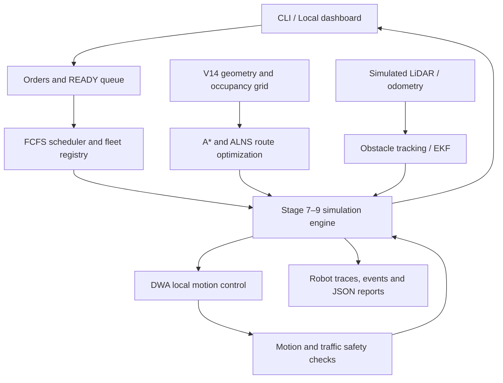

# Autonomous Multi-Robot Food Delivery System

A Python-based robotics simulation for autonomous food delivery inside an L-shaped cafeteria. Robots receive food orders, navigate between counters and tables, avoid obstacles, coordinate with other robots, and **return to their assigned base before becoming available for another order**.

The project uses the recovered **Cafeteria V14** environment, a modular robotics engine, and a local browser dashboard. The integrated **Stages 1–9** simulation runs in Python independently of Blender. Blender is currently used for scene authoring/extraction and earlier offline demonstrations; **the Stages 7–9 multi-robot simulation is not yet integrated into Blender playback**.

## Features

| Area | Current implementation |
|---|---|
| Orders and scheduling | READY-time FCFS queue, robot assignment, order lifecycle and event logging |
| Cafeteria mapping | V14 geometry, occupancy grid, pickup/drop-off waypoints, **four wall-verified entrances** |
| Global navigation | A* path planning and ALNS-based route-segment optimization |
| Local navigation | Dynamic Window Approach (DWA), kinematic motion and collision checks |
| Perception | Simulated LiDAR, basic obstacle tracking and EKF pose estimation |
| Fleet coordination | 1–4 robots, conservative traffic/yielding logic and collision checks |
| Robot lifecycle | Pickup → delivery → **return to base** → available for reassignment |
| Monitoring | Local browser dashboard with map, orders, robot states and simulation controls |

## Architecture at a glance



For module responsibilities, data flow and implementation limits, see **[Architecture](docs/architecture.md)**.

## Getting started

**Requirements:** Python 3.12 recommended; macOS, Linux or Windows for the Python simulation. Runtime code uses the Python standard library. Development tools are installed through the `dev` extra. Blender is **not required** for the commands below.

From the project root (the directory containing `pyproject.toml`):

```bash
python3.12 -m venv .venv
source .venv/bin/activate
python -m pip install -e '.[dev]'
python -m pytest -q
```

On Windows, activate with `.venv\Scripts\activate` instead.

### Run the integrated simulation

```bash
python tools/run_stage79.py
```

The default scenario creates **2 robots and 3 orders** in the exported cafeteria. Reports are written to:

- `outputs/stage79_report.json` — completion, clearance, entrance and optimization metrics
- `outputs/stage79_trace.json` — robot trajectories, planned routes and event history

Select a supported robot count and customize orders using `TABLE:STATION` identifiers:

```bash
python tools/run_stage79.py --robots 3 --orders T11:SANDWICH T12:JUICE T13:TEA
```

The CLI supports **1–4 robots**. Requested table and station names must exist in the recovered environment.

For the separately validated *single-pedestrian* scenario:

```bash
python tools/run_stage79.py --robots 1 --orders T11:SANDWICH --pedestrian
```

This compares its trajectory against a pedestrian-free baseline. It is **not** yet a general-purpose crowds simulator.

### Open the Stage 9 dashboard

```bash
python tools/stage79_dashboard.py
```


## Verification

The integrated project was run on macOS with the following **user-reported VS Code results**:

| Measure | Result |
|---|---:|
| Automated tests | **674 passed** |
| Integrated scenario | **Success** |
| Robots / delivered orders | **2 / 3** |
| Entrances classified | **4** |
| Robots returned to base and available | **2** |
| Return before reassignment | **True** |
| ALNS initial → optimized route cost | **86.296 → 77.679** |
| Simulation duration | **227.5 simulated seconds** |
| Minimum inter-robot clearance reported | **0.157 m** |

The ALNS objective decreased by approximately **10%** in this scenario; that is **not** a measured 10% reduction in delivery time. Pedestrian clearance was `null` in this default run because the optional pedestrian scenario was **not enabled**.

## Repository layout

```text
AIFR_Project/
├── AIFR_Cafeteria_V14_Recovered.blend   # Original recovered scene
├── data/reference_cafeteria/          # Stage 1–6 extracted environment, grid, report
├── src/aifr/
│   ├── common/                        # Events, clock, shared types
│   ├── config/                        # Configuration models
│   ├── orders/                        # Order records and state transitions
│   ├── fleet/                         # Robot registry and availability
│   ├── scheduling/                    # FCFS queue, scheduler, assignment ledger
│   ├── environment/                   # Geometry extraction and waypoint generation
│   ├── navigation/                    # A*, ALNS, DWA, kinematics, collision checks
│   ├── perception/                    # LiDAR, obstacle tracking, EKF
│   └── simulation/                    # Original and DWA delivery components
├── tools/
│   ├── stage79_engine.py              # Integrated fleet simulation
│   ├── run_stage79.py                 # Command-line simulation runner
│   ├── stage79_dashboard.py           # Local browser interface
│   ├── stage79_scenarios.py           # Pedestrian test scenario
│   └── blender_stage16_bridge.py      # Earlier Blender scene adapter
├── tests/                              # Automated tests
├── docs/
│   ├── architecture.md
│   ├── environment.md 
│   ├── phases.md              
└── pyproject.toml
```

## Scope and next steps

**Working in Python:** Stages 1–9 functionality shown above, including four geometry-verified entrance classifications and return-before-reassignment. The project also retains earlier Blender bridge scripts; these do **not** constitute verified Stages 7–9 multi-robot Blender integration.

**Still to do:** Verify the full multi-robot trajectory visually in Blender, support richer pedestrian traffic and larger fleets, strengthen deadlock/recovery behavior, and validate the simulation under more demanding scenarios. The current ALNS component optimizes individual route geometry; **order assignment remains FCFS**, not an ALNS vehicle-routing solver.

For reproduction details, see [`STAGES_7_TO_9_VERIFICATION.md`](STAGES_7_TO_9_VERIFICATION.md).
