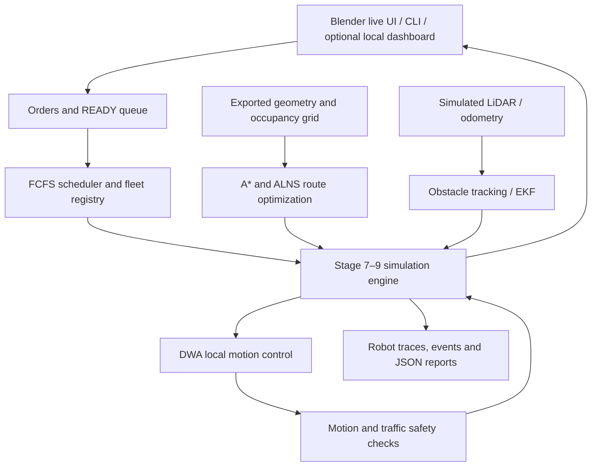

# Autonomous Multi-Robot Food Delivery System

A Python-based robotics simulation for autonomous food delivery inside an L-shaped cafeteria. Robots receive food orders, navigate between counters and tables, avoid obstacles, coordinate with other robots, and **return to their assigned base before becoming available for another order**.

The live Blender controller runs the fixed-step **Stages 1–9** Python engine
inside the recovered **Cafeteria V13** scene. The engine also runs independently
of Blender, with an optional browser dashboard.

## Features

| Area | Current implementation |
|---|---|
| Orders and scheduling | READY-time FCFS queue, robot assignment, order lifecycle and event logging |
| Cafeteria mapping | Exported geometry, occupancy grid, pickup/drop-off waypoints, **four wall-verified entrances** |
| Global navigation | A* path planning and ALNS-based route-segment optimization |
| Local navigation | Dynamic Window Approach (DWA), kinematic motion and collision checks |
| Perception | Simulated LiDAR, basic obstacle tracking and EKF pose estimation |
| Fleet coordination | 1–4 robots, conservative traffic/yielding logic and collision checks |
| Robot lifecycle | Pickup → delivery → **return to base** → available for reassignment |
| Monitoring | Blender-native UI with customers, orders, battery and charger telemetry, traffic diagnostics, and speed controls |

## Architecture at a glance



For module responsibilities, data flow and implementation limits, see **[Architecture](docs/architecture.md)**.

## Getting started

**Requirements:** Python 3.12 recommended; macOS, Linux or Windows for the Python simulation. Runtime code uses the Python standard library. Development tools are installed through the `dev` extra. Blender is **not required** for the commands below.

From the project root (the directory containing `pyproject.toml`):

```bash
python3.12 -m venv .venv
source .venv/bin/activate
python -m pip install -e '.[dev]'
python -m pytest -q
```

On Windows, activate with `.venv\Scripts\activate` instead.

### Run the integrated simulation

```bash
python tools/run_stage79.py
```

The default scenario creates **2 robots and 3 orders** in the exported cafeteria. Reports are written to:

- `outputs/stage79_report.json` — completion, clearance, entrance and optimization metrics
- `outputs/stage79_trace.json` — robot trajectories, planned routes and event history

Select a supported robot count and customize orders using `TABLE:STATION` identifiers:

```bash
python tools/run_stage79.py --robots 3 --orders T11:SANDWICH T12:JUICE T13:TEA
```

The CLI supports **1–4 robots**. Requested table and station names must exist in the recovered environment.

For the separately validated *single-pedestrian* scenario:

```bash
python tools/run_stage79.py --robots 1 --orders T11:SANDWICH --pedestrian
```

This compares its trajectory against a pedestrian-free baseline. It is **not** yet a general-purpose crowds simulator.

### Open the Stage 9 dashboard

```bash
python tools/stage79_dashboard.py
```

Visit **http://127.0.0.1:8765** in your browser. The dashboard supports order creation, map and fleet monitoring, start/pause/step, speed control, emergency stop, reset, and report export. The server binds locally; it is not a hosted service.

## Verification

The integrated project was run on macOS with the following **user-reported VS Code results**:

| Measure | Result |
|---|---:|
| Automated tests | **674 passed** |
| Integrated scenario | **Success** |
| Robots / delivered orders | **2 / 3** |
| Entrances classified | **4** |
| Robots returned to base and available | **2** |
| Return before reassignment | **True** |
| ALNS initial → optimized route cost | **86.296 → 77.679** |
| Simulation duration | **227.5 simulated seconds** |
| Minimum inter-robot clearance reported | **0.157 m** |

The ALNS objective decreased by approximately **10%** in this scenario; that is **not** a measured 10% reduction in delivery time. Pedestrian clearance was `null` in this default run because the optional pedestrian scenario was **not enabled**.

## Repository layout

```text
AIFR_Project/
├── AIFR_Cafeteria_V13_Recovered.blend   # Recovered live demo scene
├── data/reference_cafeteria/          # Stage 1–6 extracted environment, grid, report
├── src/aifr/
│   ├── common/                        # Events, clock, shared types
│   ├── config/                        # Configuration models
│   ├── orders/                        # Order records and state transitions
│   ├── fleet/                         # Robot registry and availability
│   ├── scheduling/                    # FCFS queue, scheduler, assignment ledger
│   ├── environment/                   # Geometry extraction and waypoint generation
│   ├── navigation/                    # A*, ALNS, DWA, kinematics, collision checks
│   ├── perception/                    # LiDAR, obstacle tracking, EKF
│   └── simulation/                    # Original and DWA delivery components
├── tools/
│   ├── stage79_engine.py              # Integrated fleet simulation
│   ├── run_stage79.py                 # Command-line simulation runner
│   ├── stage79_dashboard.py           # Local browser interface
│   ├── stage79_scenarios.py           # Pedestrian test scenario
│   └── blender_stage16_bridge.py      # Earlier Blender scene adapter
├── tests/                              # Automated tests
├── docs/architecture.md               # Technical architecture
└── pyproject.toml
```

## Scope and next steps

**Working in Python:** Stages 1–9 functionality shown above, including four geometry-verified entrance classifications and return-before-reassignment. The project also retains earlier Blender bridge scripts; these do **not** constitute verified Stages 7–9 multi-robot Blender integration.

**Still to do:** Verify the full multi-robot trajectory visually in Blender, support richer pedestrian traffic and larger fleets, strengthen deadlock/recovery behavior, and validate the simulation under more demanding scenarios. The current ALNS component optimizes individual route geometry; **order assignment remains FCFS**, not an ALNS vehicle-routing solver.

For reproduction details, see [`STAGES_7_TO_9_VERIFICATION.md`](STAGES_7_TO_9_VERIFICATION.md).

## Blender-native live demonstration

Run from the Git-connected repository root:

```bash
/Applications/Blender.app/Contents/MacOS/Blender "$(pwd)/AIFR_Cafeteria_V13_Recovered.blend" --python "$(pwd)/tools/blender_integration_live.py"
```

Open **N → AIFR** in the 3D viewport.

1. Click **Add Robot** at the top of the sidebar to create Robot 2.
   Under **Robot Battery & Charging**, select Robot 2, set **Battery %**
   to **14**, then click **Apply Battery Level**. The sidebar and floating
   label reflect the battery manager immediately.
2. Click **Start** or **Step** to run the engine's decision loop. A low robot
   reserves a charger and drives there if it is away from a pad. A robot already
   parked on its base charger can start charging there. By default, idle robots
   start charging only below 15% and finish at 90% if no feasible order is
   assigned first. Above 15%, a robot charging at its own base can leave when
   selected for an order that fits its available energy and reserve. An idle
   robot above the cutoff stays idle if it cannot safely take a waiting trip.
   Look for the labeled pads and the sidebar queue.
   To see a physical return, keep Robot 1 charging so Robot 2 takes a customer
   order, then apply 14% to Robot 2 just after it leaves its base.
3. Set **Consumption multiplier** and click **Apply Consumption** to change
   the energy used for driving, turning and standby. **Restore Battery Defaults**
   restores the live defaults while preserving each robot's current charge.
   The live defaults use 10% more energy for driving, turning and standby than
   the shared engine defaults. Charging from 15% to 90% still takes roughly
   two simulated hours. High consumption multipliers can offset the charger's
   output.
4. Select an entrance or use **Automatic**, select a **Food station**, and
   click **Add Customer**. The customer pays, sits in a randomly reserved chair,
   then becomes eligible for delivery at the chair's table. Once served, the
   customer eats for 20–40 real-world seconds and releases the seat after
   standing and clearing it. Simulation speeds from 1× to 16× set a wall-clock
   target for fixed physics ticks. Busy scenes can run below the target when
   the computer cannot process the ticks in time. The eating deadline uses real
   time at every speed.

For rush hour, set **Entrance** to **Automatic**, choose a food station, and
click **Start Rush**. The default batch is 36 customers. Rush arrivals are
spread across the four doors and fill three standing positions near **CASH**.
One customer pays at a time while the next customers are already inside the
cafeteria. Customers walk at 1.15 m/s during the rush and their orders become
ready after they sit. **Reset** restores the normal arrival flow.

Chargers double as base parking spots. A fully charged robot at its own base
can accept work immediately, and its charger reservation clears when it
physically leaves the pad. Robots that cannot safely drive to their base on
the remaining charge may fault. Use **Reset** to start a fresh demonstration.

For repeatable acceptance runs and current limitations, see
[Integration verification](INTEGRATION_VERIFICATION.md).
