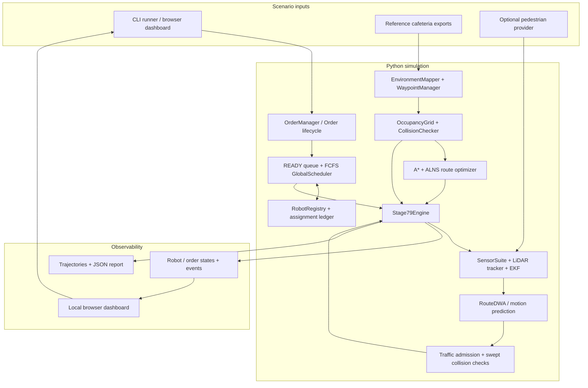

# System Architecture

**Autonomous Multi-Robot Food Delivery System · Implemented Stages 1–9**

[← Project README](../README.md) · [Verification guide](../STAGES_7_TO_9_VERIFICATION.md)

## 1. Overview

The system is a **fixed-step, 2D kinematic robotics simulation** whose reference environment comes from the recovered Blender **Cafeteria V14** scene. Python owns order management, path planning, robot motion, sensor simulation, collision validation and reporting. The local browser dashboard is a client of the Python engine.

**Current integration boundary:** Scene data was exported from Blender in Stages 1–6 and is loaded by the Stages 7–9 Python runner from `data/reference_cafeteria/`. The engine does **not** currently control robot objects live in Blender. Earlier Blender bridges provide offline demonstrations; integrated multi-robot Blender animation is the next integration step.

## 2. Implemented data flow



Conceptually, each simulation tick advances the clock, assigns eligible READY orders, updates per-robot perception and motion, validates safety, progresses mission states, and records events/trace samples. The diagram shows logical dependencies rather than a literal call graph.

## 3. Source layout and ownership

| Source | Responsibility | Important implementation |
|---|---|---|
| `src/aifr/common/` | Simulation time, shared types, events | `SimClock`, `EventBus` |
| `src/aifr/orders/` | Order creation and transitions | `OrderManager`, `OrderStatus` |
| `src/aifr/fleet/` | Robot inventory and status | `RobotRegistry` |
| `src/aifr/scheduling/` | READY-order queuing and dispatch | `GlobalScheduler`, assignment ledger |
| `src/aifr/environment/` | Cafeteria classification and waypoints | `EnvironmentMapper`, `WaypointManager` |
| `src/aifr/navigation/occupancy_grid.py` | Traversability representation | `OccupancyGrid` |
| `src/aifr/navigation/astar.py` | Global path construction | `find_path` |
| `src/aifr/navigation/alns.py` | Geometric path improvement | `ALNSRouteOptimizer` |
| `src/aifr/navigation/dwa.py`, `dwa_route.py` | Local velocity selection and route following | `DWAPlanner`, `RouteDWA` |
| `src/aifr/navigation/collision_checker.py` | Geometric safety checks | `CollisionChecker` |
| `src/aifr/perception/` | Noisy readings, obstacle observations, pose estimation | `SensorSuite`, `lidar_scan`, `LiDARObstacleTracker`, `PoseEKF` |
| `tools/stage79_engine.py` | Integrated tick loop and robot mission orchestration | `Stage79Engine`, `RobotRuntime` |
| `tools/run_stage79.py` | Reproducible CLI scenarios and JSON exports | `main` |
| `tools/stage79_dashboard.py` | Local HTTP dashboard / user controls | `Stage79App` |
| `tools/stage79_scenarios.py` | Reproducible optional pedestrian scenario | `v14_pedestrian` |
| `tools/blender_stage16_bridge.py` | Existing Blender-to-Python demonstration adapter | Stage 1–6 bridge |

The integrated entry points live in `tools/`; the reusable foundational logic lives under `src/aifr/`. There is no ROS dependency and no separate FastAPI/React backend in this version.

## 4. Environment and entrance mapping

The runner loads three reference files:

```text
data/reference_cafeteria/
├── stage3_environment.json
├── stage4_occupancy_grid.json
└── stage36_report.json
```

`load_reference()` in `tools/stage79_engine.py` checks that the Stage 1–6 reference mission succeeded. It reads `v14_door_metadata` from the report and compares four specified door openings against the exported wall rectangles through `EnvironmentMapper`. The integrated scenario requires **exactly four wall-verified entrance classifications**.

**What this means:** There are four physically validated wall openings in the scene representation. This does **not** imply every doorway centre is passable by the robot's conservatively inflated occupancy grid; clearance through individual entrances must be separately tested.

Route planning uses validated pickup, delivery and base waypoints on the occupancy grid. Full footprint and inter-agent safety checks are applied during motion.

## 5. Order scheduling and return-to-base lifecycle

The scheduler preserves **READY-time FCFS** ordering and robot availability rules. The integrated engine constructs it with `release_on_delivery=False`.

```mermaid
stateDiagram-v2
    [*] --> IDLE
    IDLE --> TO_PICKUP: READY order assigned
    TO_PICKUP --> LOADING: counter reached
    LOADING --> TO_CUSTOMER: loading completed
    TO_CUSTOMER --> UNLOADING: table reached
    UNLOADING --> RETURNING: order marked DELIVERED
    RETURNING --> IDLE: base reached; assignment released
    IDLE --> TO_PICKUP: next eligible assignment
```



Order completion and robot availability are **different events**:

- When the robot finishes unloading, the **order** becomes `DELIVERED`.
- The **robot** remains unavailable while `RETURNING` to its own base.
- On confirmed base arrival, the engine invokes the scheduler's return-completion behavior; only then can the robot accept a new order.
- The older scheduler can still be constructed in its original release-on-delivery mode for backward compatibility with Stage 2 tests. The **integrated Stage 8 engine disables early release**.

Robot faults and navigation failure are recorded rather than silently bypassed. The engine uses distinct robot runtime phases and order statuses; not all runtime phases are order-status enum values.

## 6. Navigation and perception

### Global route planning

A* finds an initial traversable route on the occupancy grid. `ALNSRouteOptimizer` then attempts to reduce the route objective using path-segment destruction/repair, collision-free shortcuts and turn penalties.

**Current ALNS scope:** It optimizes **individual route geometry** for fixed endpoints. It does not reorder the READY queue, solve a multi-vehicle routing problem, or optimize fleet-wide pickup assignment. In the user's default run the combined ALNS route objective changed from **86.296 to 77.679** (~10% reduction). This is not a delivery-time improvement claim.

### Local navigation

The route-following DWA component selects linear/angular velocity commands constrained by configured speed/acceleration limits. It predicts short local trajectories and checks static map clearance and nearby obstacle trajectories. The global route is retained as guidance while the local planner reacts to obstacles.

### Sensor and pose estimation

The Python simulation models LiDAR ranges and odometry; a LiDAR adapter converts detections to tracked obstacle representations, while an EKF estimates robot pose. The integrated default `RobotRuntime` currently uses **zero sensor-noise standard deviations**. Thus default-run success is **not** evidence of robustness to realistic sensor noise, occlusion or uncertain pedestrian motion.

### Multi-robot coordination

The engine admits robots conservatively into contested narrow areas, checks relative robot clearance along each step and delays movement when necessary. This supports the verified two-robot scenario but is not a formal deadlock-free multi-agent planner. Traffic can become slow or stalled as density increases.

## 7. Engine, dashboard and output contracts

### CLI

```bash
python tools/run_stage79.py
python tools/run_stage79.py --robots 3 --orders T11:SANDWICH T12:JUICE T13:TEA
python tools/run_stage79.py --robots 1 --orders T11:SANDWICH --pedestrian
```

Supported robot count is **1–4**; `--pedestrian` is restricted to the **one-robot** comparison scenario. The default is two robots and three orders, with no pedestrian. The runner uses `dt = 0.05 s` in its exported trace and stops on completion or the tick limit.

### Dashboard

```bash
python tools/stage79_dashboard.py
```

The dashboard runs on **127.0.0.1:8765** by default. Its HTTP interface exposes state, map, report, order creation and simulation controls. It supports start/resume, pause, step, speed, emergency stop, reset and saving the current report. It is a local development interface, **not** an authenticated remotely hosted product.

### Outputs

| Path | Content |
|---|---|
| `outputs/stage79_report.json` | Overall success, orders, fleet state, entrances, ALNS costs, clearances, errors |
| `outputs/stage79_trace.json` | Per-robot trajectory samples, route records, event history, time step |
| `outputs/stage79_dashboard_report.json` | Dashboard-saved state report when explicitly requested |

These outputs are generated by the Python simulation, not by Blender. The cafeteria source `.blend` is not rewritten by these commands.

## 8. Verified scenario and limitations

**User-reported macOS/VS Code verification:** 674 tests passed; the default two-robot, three-order simulation completed successfully in **4,550 ticks / 227.5 simulated seconds**, with **four wall-verified entrances**, both robots back at base and `return_before_reassignment=true`. The reported minimum inter-robot clearance was approximately **0.157 m**. The report's pedestrian fields were `null` because the default scenario omitted pedestrians.

### Not yet verified or implemented as a general capability

- Live synchronized multi-robot Blender animation/control for Stages 7–9.
- General crowds, multiple moving pedestrians, or arbitrary pedestrian spawning.
- More than four robots in the current `Stage79Engine` configuration.
- Guaranteed recovery from all local minima, congestion or deadlock cases.
- Real-world hardware, motor dynamics, physical LiDAR noise or occlusion fidelity.
- ALNS optimization of fleet-wide order allocation or full vehicle-routing schedules.

**Recommended next boundary:** Verify the optional pedestrian comparison and inspect the local dashboard, then build a Blender adapter that **consumes the validated `stage79_trace.json`** and animates all robots without changing the approved cafeteria scene.

## Live Blender integration and hardening (November 2026)

The Blender-native controller is `tools/blender_integration_live.py`, using
`tools/stage79_engine.py` and `tools/customer_flow.py` directly in Blender's
main-thread timer. It does **not** require localhost. Customer payment creates
an order linked through `customer_orders` and `order_customers`; the engine
checks robot/order custody before delivery confirmation. `tools/deadlock_manager.py`
checks swept pedestrian motion against both robots and other customers.

`tools/geometry_hardening.py` audits pickup egress and candidate waiting spots
on the recovered V14 occupancy grid. Stationary DWA stalls have at most two
bounded route-recovery attempts, after which the robot enters a visible fault.
The live route admission policy is still **exclusive shared-aisle ownership**;
it prevents opposing active robots but is not proof of general deadlock freedom.

See `INTEGRATION_VERIFICATION.md` for test commands, benchmarked scenarios and
explicit limitations. Blender's 1×–16× controls are **targets**, limited by
CPU and per-timer work budgets, not guaranteed real-time throughput.
