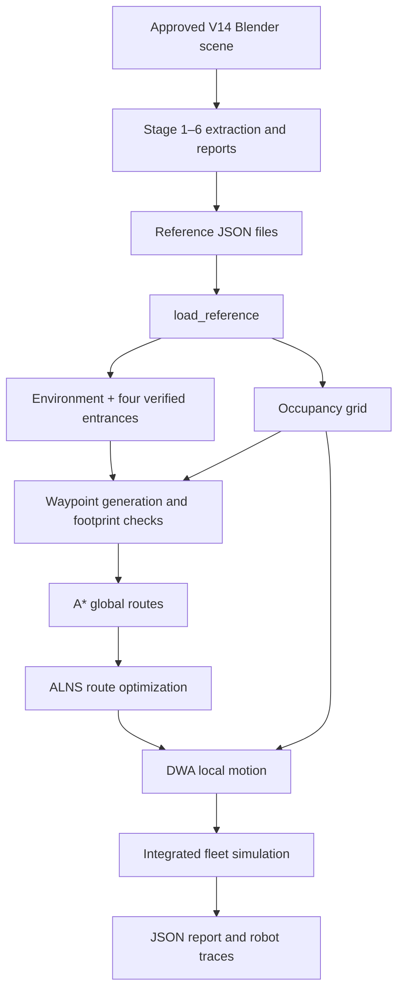

# Cafeteria Environment and Mapping

*Autonomous Multi-Robot Food Delivery System · Integrated Stages 1–9*

[← README](../README.md) · [System architecture](architecture.md) · [Development plan](phases.md)

## 1. Environment source and scope

The project uses the team's approved **Cafeteria V14**, an L-shaped indoor environment created in Blender. The included scene file is:

```text
AIFR_Cafeteria_V14_Recovered.blend
```

For the integrated **Python Stages 7–9 simulation**, the authoritative *runtime inputs* are the exports checked into:

```text
data/reference_cafeteria/
├── stage3_environment.json       # Extracted floor and object geometry
├── stage4_occupancy_grid.json    # Traversability grid
└── stage36_report.json           # Stage 1–6 validation and door metadata
```

The runtime loads these existing exports; it **does not re-extract the `.blend` scene** on every run. If the Blender model changes, the reference exports must be regenerated and revalidated together. Never silently edit approved cafeteria geometry to make navigation tests pass.

The Stage 1–6 Blender bridge remains available at `tools/blender_stage16_bridge.py`. The integrated Stages 7–9 simulation runs independently in Python; full multi-robot Blender playback is **not yet connected**.

## 2. Layout and coordinate system

Navigation uses the horizontal **XY plane**, with distances in metres. The exported floor consists of two connected rectangles:

| Floor region | X range (m) | Y range (m) |
|---|---:|---:|
| Lower arm (`FLOOR_arm`) | 0–19 | 0–7.5 |
| Upper wing (`FLOOR_wing`) | 9–19 | 7.5–17.5 |

Together these form an **L**, not a fully walkable 19 × 17.5 m rectangle. Space outside those floor regions is invalid for robot motion, even when it lies inside the occupancy grid's outer bounding box.

The physical objects and waypoints use the exported scene's world coordinates. When changing the scene, keep extraction, obstacle geometry and waypoint coordinates consistent.

## 3. Verified scene inventory

The included Stage 1–6 reference report records:

| Object type | Count |
|---|---:|
| Scene objects | 733 |
| Floor regions | 2 |
| Wall segments | 10 |
| Pillars | 6 |
| Tables | 18 |
| Chairs | 72 |
| Counters | 6 |
| Unknown classified objects | 0 |

The counters include the food pickup stations **Main Course, Tea, Sandwich and Juice**, plus the **Hand Wash** and **Cash/Billing** service areas. Counters, walls, pillars, tables and chairs are treated as physical obstacles, with separate approach waypoints for service and delivery.

The extraction also records decorative and other intentionally skipped objects. The zero *unknown* count does not mean that every scene object is a navigation obstacle.

## 4. Entrances: Stage 7 correction

**The four entrances are now classified and checked against the exported wall geometry by the integrated loader.** The original Stage 1–6 JSON still contains `entrances: []` and reports `entrances_classified: 0`, because that export was produced *before* the correction. This is expected: the current Python loader applies the correction at runtime, rather than rewriting the historical report.

The four opening locations come from `stage36_report.json` → `v14_door_metadata`:

| Entrance metadata key | Approximate XY centre (m) |
|---|---|
| `main_entry` | (4.1, 7.5) |
| `side_exit_1` | (19.0, 3.8) |
| `side_exit_2` | (19.0, 11.1) |
| `sliding_entry_t11` | (9.0, 9.0) |

`tools/stage79_engine.py` → `load_reference()` reconstructs the entrance objects through `EnvironmentMapper`, checks each opening against the **actual exported wall rectangles**, and requires **exactly four** verified entrances before the scenario starts.

**What this validation does not establish:** It does not prove that the inflated robot footprint can traverse every entrance from either direction. Opening classification, geometric clearance and route accessibility are distinct tests. The integrated simulation's successful runs also do not independently revalidate a changed `.blend` scene.

## 5. Occupancy grid and collision model

The included Stage 4 navigation grid is:

| Property | Value |
|---|---|
| Grid dimensions | 190 × 175 cells |
| Cell resolution | 0.10 m |
| Origin | (0.0, 0.0) m |
| Free cells in the reference report | 11,229 |
| Cell encoding | `0` = free, `1` = blocked |

`src/aifr/navigation/occupancy_grid.py` supplies coordinate conversion and grid checks. The grid is a conservative discretized navigation representation of the V14 floor and obstacles.

`src/aifr/navigation/collision_checker.py` performs geometry-level robot-footprint checks. The reference robot is approximately **0.40 × 0.36 m**, with a separate clearance margin (the `CollisionChecker` default is **0.05 m**). Grid-centre tests alone are not sufficient for physical safety; the integrated engine also checks motion and proximity to other agents.

Navigation must keep robots clear of walls, tables, chairs, pillars, counters, outside-floor regions and other robots. The current implementation uses 2D kinematics and a discrete simulation, not Blender rigid-body physics.

## 6. Pickup, delivery and base waypoints

`src/aifr/environment/waypoint_manager.py` generates candidate positions near relevant scene features; the Stage 7–9 engine keeps only waypoints whose grid cells are free. It uses **counter approach points**, not the centres of physical counters, and **table approach points**, not table centres.

The original Stage 1–6 report's example mission uses:

| Purpose | Reference position (m) |
|---|---|
| Spawn | (5.90, 6.45) |
| Sandwich pickup | (8.85, 1.675) |
| T11 delivery | (10.90, 7.73) |

These coordinates describe one historical demonstration, **not a guarantee that every later order uses the same point**. The integrated engine selects reachable pickup and delivery waypoints for each order.

### Multiple robot base camps

`Stage79Engine` supports **1–4 robots** in its current CLI. It starts from validated spawn candidates and constructs distinct, collision-checked base slots around the primary base area. It requires separation between base slots and checks route connectivity.

The robot lifecycle is:

```text
IDLE at base
    ↓ assigned an order
Travel to pickup → Load → Travel to table → Deliver
    ↓
RETURNING to assigned base
    ↓ base arrival confirmed
IDLE / available for reassignment
```

The integrated scheduler uses **READY-time FCFS** for assignment and defers releasing a robot until it returns. The original Stage 2 behavior is retained for its own legacy tests; the integrated engine explicitly opts into return-before-reassignment.

## 7. How the environment enters navigation



Module locations:

| Concern | Implementation |
|---|---|
| Scene extraction and classification | `src/aifr/environment/` |
| Grid and static collision tests | `src/aifr/navigation/occupancy_grid.py`, `collision_checker.py` |
| A* and ALNS | `src/aifr/navigation/astar.py`, `alns.py` |
| Local path tracking and DWA | `src/aifr/navigation/dwa_route.py`, `dwa.py` |
| LiDAR observations and pose estimation | `src/aifr/perception/` |
| Scenarios, validated reference loading and robot simulation | `tools/stage79_engine.py`, `stage79_scenarios.py` |

The environment provides *geometry*. Order scheduling, motion control, inter-robot yielding and return-to-base states are implemented in the higher-level simulation engine.

## 8. Running and validating the integrated environment

From the repository root, using the project's Python 3.12 environment:

```bash
python -m pytest -q
python tools/run_stage79.py
```

This reads the three bundled reference files and writes:

```text
outputs/stage79_report.json
outputs/stage79_trace.json
```

For an independent scenario with one simulated pedestrian:

```bash
python tools/run_stage79.py --robots 1 --orders T11:SANDWICH --pedestrian
```

The pedestrian mode is currently a **single, controlled test scenario**, not general crowd generation. Run it separately and inspect the output; the normal default scenario does not include a pedestrian.

### Reported verification on macOS / VS Code

The user successfully ran **674 Python tests** and the default integrated scenario. Its report showed:

| Metric | Result |
|---|---:|
| Overall simulation | Success |
| Robots | 2 |
| Delivered orders | 3 |
| Wall-verified entrance classifications | 4 |
| Robots returned to base and available | 2 |
| Return-before-reassignment | `true` |
| Simulation duration | 4,550 ticks (227.5 simulated seconds) |
| Minimum inter-robot clearance | ~0.157 m |
| Pedestrian clearance | Not measured in the default run (`null`) |

These are **results from the tested Python simulation**. They do not establish Blender playback success, full scene-to-export parity after future edits, robustness to noisy sensing, or safety under arbitrary crowded conditions.

## 9. Change control and remaining checks

When updating the cafeteria or adding simulation complexity:

- Keep the approved `.blend` source unchanged unless a new scene version is explicitly reviewed.
- Regenerate and inspect the scene export, occupancy grid and reference report **together** after any accepted geometry change.
- Require all four entrances to be classified, then separately test whether routes can actually traverse their openings with the robot footprint.
- Validate counter/table approaches and distinct robot base slots for the selected scenario.
- Rerun the full test suite and static multi-robot run; separately run the pedestrian scenario if obstacle response has changed.
- Check that all robots return to base before being reassigned, and review minimum clearances rather than relying on `success: true` alone.
- Treat integration of Stages 7–9 trajectory playback, multiple pedestrians and larger robot fleets into Blender as **future work**, not already delivered capabilities.

For simulation architecture and current limitations, see [architecture.md](architecture.md).
